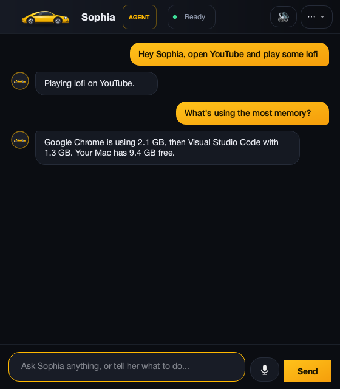

# Sophia

**A personal AI assistant that lives on your computer.** Say "Hey Sophia" or type, and it gets things done: opens any app or website, searches the web, finds and manages your files, controls your screen, sets reminders and routines, and talks back. Runs on **macOS** and **Windows**, powered by Google Gemini with your own free API key. Speech recognition and the voice run offline.

[](https://github.com/ds1734770-dot/Sophia/actions/workflows/ci.yml)
[](https://github.com/ds1734770-dot/Sophia/releases)


[](LICENSE)

<p align="center">
  
  &nbsp;&nbsp;&nbsp;
  
</p>

> "Hey Sophia, open YouTube" · "Open Chrome" · "Find my resume and summarize it" · "Remind me at 6pm" · "What's using my memory?" · "Call Mom on WhatsApp"

## Before you install

You need three things:

| | |
| --- | --- |
| **A computer** | macOS 13 or later (Apple silicon or Intel), or Windows 10/11, with about 2 GB free |
| **A Gemini API key** (free) | Sophia's "brain". See the steps below; it takes two minutes |
| **A microphone** (optional) | for "Hey Sophia" and voice requests; typing works without one |

You do **not** need to install Python, Git or anything else first: the installer brings its own Python 3.12 and every package Sophia uses (about 120 Python packages, through [uv](https://github.com/astral-sh/uv), into a private folder), and downloads the offline speech models (about 500 MB) once.

### Get your Gemini API key

1. Open **[aistudio.google.com/apikey](https://aistudio.google.com/apikey)** and sign in with a Google account.
2. Click **Create API key** (choose or create any project when asked).
3. Copy the key (it starts with `AIza`). Keep it private, like a password.

The setup asks you to paste it and stores it in the macOS Keychain or Windows Credential Manager, never in a file. The free tier is enough for everyday use (Sophia spreads requests across several models and answers simple commands without using it); on the free tier Google may use your requests to improve its products, see [PRIVACY.md](PRIVACY.md).

## Install

### Option A: one line in Terminal (recommended)

macOS (Terminal):

```bash
curl -fsSL https://raw.githubusercontent.com/ds1734770-dot/Sophia/v0.3.0/install.sh | bash
```

Windows (PowerShell, no admin needed):

```powershell
irm https://raw.githubusercontent.com/ds1734770-dot/Sophia/v0.3.0/install.ps1 | iex
```

These install the **v0.3.0 release** (not the moving `main` branch). The SHA-256 of each installer is listed on the [release page](https://github.com/ds1734770-dot/Sophia/releases/tag/v0.3.0) if you want to check it.

### Option B: read the scripts first, then run them

macOS:

```bash
git clone --branch v0.3.0 https://github.com/ds1734770-dot/Sophia.git ~/Sophia
cd ~/Sophia
less scripts/setup_mac.sh        # read what it will do
scripts/setup_mac.sh
```

Windows: download [install.ps1](https://github.com/ds1734770-dot/Sophia/blob/v0.3.0/install.ps1), read it, then run `powershell -ExecutionPolicy Bypass -File install.ps1`.

### What happens next: the setup

Right after installing, the setup starts by itself (run it again any time with `sophia --setup`). It:

1. asks for your **Gemini API key** and stores it safely;
2. **scans every app installed on your computer**, so "open Chrome", "open Spotify" or "open VS Code" work straight away;
3. asks for the **permissions** voice and screen control need (microphone, accessibility, screen recording on a Mac) and checks each one, opening the right Settings page for anything missing;
4. downloads the **offline speech and voice models** (about 500 MB, once);
5. offers to start Sophia **at login**.

### Start it

Open a new Terminal window and type:

```bash
sophia
```

(or double-click `Sophia.command` in the Sophia folder on a Mac). A small yellow car drives onto your screen. Hover over it for **Voice**, **Chat** and **Hide**, or just say **"Hey Sophia"**.

| Command | What it does |
| --- | --- |
| `sophia` | the floating car (default) |
| `sophia --chat` | the chat window instead |
| `sophia --cli` | text only, in the terminal |
| `sophia --no-voice` | no microphone or spoken replies |
| `sophia --setup` | the setup again (API key, app scan, permissions, voice models) |
| `sophia --trust-plugin FILE` | allow a plugin you added (see Integrations) |
| `sophia --help` | all options |

**Update:** run the install line of the newer release. **Uninstall:** see [Install in detail](#install-in-detail).

### If something does not work

| Problem | Fix |
| --- | --- |
| `sophia: command not found` | open a **new** Terminal window (the installer added `~/.local/bin` to your PATH), or run `~/.local/bin/sophia` |
| "API key not valid" / Sophia asks for a key again | run `sophia --setup` and paste the key again; check it at aistudio.google.com/apikey |
| "Quota exceeded" | the free tier's daily limit was reached; it resets daily, or type `usage` to see requests per model. A paid key removes the limit |
| "Hey Sophia" is not heard | check the microphone permission (macOS: System Settings > Privacy & Security > Microphone, for Terminal). Then run `python -m app.voice.diagnose` in the Sophia folder: it shows what Sophia hears |
| Clicking, typing or "open WhatsApp and call..." does nothing (macOS) | allow **Accessibility** for Terminal in System Settings > Privacy & Security, then restart Sophia |
| "What's on my screen?" fails (macOS) | allow **Screen & System Audio Recording** for Terminal, then restart Sophia |
| The first voice request is slow | the speech models are still downloading or loading; it is quick after that |

Still stuck? [Open an issue](https://github.com/ds1734770-dot/Sophia/issues/new/choose) or ask in [Discussions](https://github.com/ds1734770-dot/Sophia/discussions).

## What it can do

| Area | Examples |
| --- | --- |
| Chat and learning | "Explain binary search", "Help me debug this error" |
| Web | "Who won the match last night?" (searches the web), "Summarize this article: <link>", "Weather in Vizag" |
| Apps and windows | "Open VS Code", "Open YouTube", "Close Spotify", "Minimize Chrome" |
| Files, whole PC | "Find my resume", "Summarize that PDF", "Move it to Documents", "Undo that" |
| Shell | "How much free space do I have?", "What is using port 3000?" (shows the exact PowerShell or zsh command first) |
| Screen control | "Click the Send button", "Type my email in the search box" (reads the window's controls through the system's accessibility API for exact, fast clicks; falls back to looking at the screen) |
| Screen questions | "What error is on my screen?" |
| Reminders and routines | "Remind me at 6pm", "Timer for 10 minutes", "Every weekday at 8 give me a morning briefing" |
| Notes and to-dos | "Add a to-do: finish report", "Note that the exam is on Monday" |
| System | "Volume to 30", "Battery and memory?", "Take a screenshot", "Play lofi on YouTube", "Pause the music" |
| Everyday lookups | "Convert 5 miles to km", "100 USD to INR", "Define serendipity", "Tell me about the Porsche 911", "Latest news about cricket" |
| This PC | "What is using the most memory?", "Force-close notepad", "What is filling my disk?", "Am I online?", "Zip this folder", "Switch to dark mode", "Make me a password" |
| Clipboard | "Fix the grammar of what I copied" |
| Memory | "Remember I prefer Python", "What do you know about me?", "Forget my city" |
| Voice | Say "Hey Sophia" (hands-free) or click the mic; natural spoken replies |
| Integrations | Plugins and MCP servers add email, calendar, GitHub, Spotify and more (see below) |

## The interface

Sophia is a yellow sports car that lives on your screen (an original design, no manufacturer badge). Start it from the command line:

```powershell
sophia            # the car
sophia --chat     # classic chat window instead
```

- **It drives in** from the nearest screen edge when Sophia starts, and drives off again when you hide it or quit.
- **Drag it** anywhere, like any window. The wheels turn and the car faces the way you move it; it parks facing the middle of the screen.
- **Hover over it** and the headlights come on, the engine revs, and three buttons appear below: **Voice** (listen, then answer aloud), **Chat** (open the full chat beside the car) and **Hide** (drive off).
- **Alt+S** (Mac: **Ctrl+Option+H**) hides the car or brings it back (change it with `HIDE_HOTKEY`, for example `ctrl+alt+o`). The tray icon does the same.
- **Answers** appear as a small text card above the car and are spoken. Questions get Yes / No / Always allow buttons on the card.
- The car shows what Sophia is doing: bright cool headlights that follow your voice while listening, blinking hazard lights while thinking, brake lights glowing while speaking, a headlight flash and sparkles when a task is done, a shudder on an error.
- **It is small on purpose** (130 px wide) with three tiny buttons that show their name as a tooltip. Right-click > Size picks Tiny, Small, Medium or Large, or set `CAR_WIDTH` (70 to 300).
- **Windscreen wiper:** it sweeps when you hover, when the car parks, and the whole time Sophia is thinking.
- **Sound effects** (generated in code, no files): engine arriving (nothing plays when you hover), a honk when it parks, a wiper swish, button clicks, a chime when listening starts and another when a task succeeds, a rev-and-launch when it leaves. Right-click > Sound effects mutes them; `SOUND_VOLUME` (0 to 1) sets the level. Preview them all with `python -m app.ui.sounds` (add a folder name to also save them as .wav files).
- **Right-click** the car for a menu (open chat, talk, hide, spoken replies, hands-free, reset position, quit). The car never takes keyboard focus, so it will not interrupt what you are typing elsewhere.

The chat window has an agent look: a dark surface with the car's amber accent, Sophia's mark beside each of her messages, a status pill (idle, working, listening, problem), and **live steps**: while she works, a card lists each action as it happens ("Opening Notepad", "Checking the weather in Vizag") with a spinner, a tick or a cross and its time, then folds into "Used 3 actions" (click to reopen; failures stay open). Hover a reply to copy it. The welcome screen shows the car with tap-to-send idea cards and folds away after your first message; answers stream in as Gemini writes them.

Sophia can launch any program on your PC (she shows the path, whether it is signed and whether it was downloaded; one "Always allow" covers the session), open any folder, and look at and operate anything visible on your screen.

## Speed and screen control

- **Answers stream.** Text appears as Gemini writes it and is spoken sentence by sentence, instead of everything arriving at the end.
- **Controls are read, not guessed.** For "click Send" or "type in the search box" Sophia reads the window's buttons, menus, tabs and text boxes through Windows UI Automation or the macOS Accessibility API (about half a second, no AI request, usually no mouse movement), and only looks at a screenshot for things that are not real controls (web page content, images). Password boxes are never typed into, and Sophia's own windows are never driven.
- **She knows your PC up front:** your folders, installed programs and open windows are part of every request, so she does not have to search for them.

## Appearance

Right-click the character (or use the chat window's ⋯ menu) > **Appearance** to choose how Sophia looks. The choice is remembered, applies to the floating character, the chat header and the welcome screen, and keeps the figure standing where it was.

- **Sports car** (the default): drives in, wipers, engine sounds.
- **Armored suit**: a red and gold brushed-metal powered suit drawn in code (an original design): faceplate with glowing eye slits, an arc reactor with coil segments, segmented gold abs, gauntlets with palm repulsors, boot thrusters. It hovers, waves when you hover over it, raises a hand to listen, scans with orbiting lights while thinking, gestures while speaking, flashes its palms and reactor when something needs you, and fires a repulsor blast when a task is done. Agent colours tint the red of the suit, with the other working agents as dots over its head.
  - **Arriving:** it flies in on full thrust (leaning into the flight, thrusters roaring), brakes with both palm repulsors firing rings against the fall, drops, and touches down with a shockwave, dust and a crouch before settling.
  - **Leaving:** it crouches and charges its palms, then launches straight up and away on a climbing diagonal.
  - Sounds (generated in code): thruster fly-by, repulsor whine, landing impact with a metal clank and hydraulic hiss, launch. They follow the **Sound effects** switch, and a silent arrival after the wake word plays none.

Every appearance reacts to the same events, so more can be added in `app/ui/characters.py`.

## Working your screen

Sophia can operate whatever is on your screen, the way a person would, in three layers (fastest first):

1. **Instant commands, no AI:** "click Send", "tap the search box", "type hello world", "scroll down", "select all", "copy that", "paste it", "go back", "new tab", "press enter", "refresh the page". She reads the window's controls through Windows accessibility (about a second, web pages included) and acts at once.
2. **Skills, no AI:** "Open WhatsApp and call Srino", "video call Mom on WhatsApp", "message Raj on WhatsApp saying I'll be late". They open WhatsApp, find the chat, and call or send through the accessibility tree, so they are quick and do not use the Gemini quota. If WhatsApp is not signed in, she says so.
3. **The screen agent, for anything else:** "search YouTube for lofi and play the first video". Gemini decides each step; after every action it is shown the screen again (numbered controls and what changed) to check its own work. It stops when it is done, when it needs to ask you something, at 25 steps or 3 minutes, or when you stop it.

**Autonomy.** By default she works through a task without asking (`SCREEN_AUTONOMY=auto`); `ask` makes her confirm each click and keystroke. While she works, an amber border and a "Sophia is working" pill show on the screen, ripples mark where she clicks, and every step appears in the chat's live steps card.

**Stopping her.** Press **Ctrl+Alt+X** (`STOP_HOTKEY`), click the red **Stop** chip, or throw the mouse into a screen corner. The next action is refused and the task ends.

**What she never touches, however autonomous she is:** banking and payment pages, password managers and password boxes (and fields called password, code, OTP, card number, PIN), Windows settings and security windows, and her own windows. A forbidden window ends the task. Add your own words with `SCREEN_BLOCKED=metatrader,zerodha`. Text on the screen is treated as data, never as instructions.

**Limits.** She cannot control windows running as administrator, the lock screen or UAC prompts; games and custom-drawn apps expose few controls. The screen agent spends one Gemini request per step, and the free tier allows only about 20 requests per model per day, so use the skills and instant commands for common tasks (or a paid Gemini key for heavy use).

## How it decides what to do

Gemini decides. Sophia gives it a set of tools (open app, search the web, read a file, run a shell command, click on the screen, and so on) and it chooses which to call, chaining several when a task needs it. Exact commands ("open notepad", "what time is it", "12*(5+8)", "volume to 30", "pause", "timer for 10 minutes", "weather", "battery", "convert 5 miles to km", "define word") are answered locally in a fraction of a second without using any AI quota; anything vague goes to Gemini. Gemini replies are faster too: one shared connection, a low thinking level (`THINKING_LEVEL`), and several lookups at once when it asks for them together.

## Safety

Every action goes through one registry with three tiers:

- **Runs immediately:** reading and low-risk actions (open an app, search the web, find or read files, check status).
- **Asks first:** closing apps, writing, renaming, moving or copying files, clicking and typing on the screen (with `SCREEN_AUTONOMY=ask`), running shell commands. Answer **Yes**, **No**, or **Always allow** to stop asking for that kind of action until Sophia restarts. Shell commands can never be "always allowed". Looking at the screen (a screenshot sent to Gemini) happens when a request needs it; turn on **Ask before looking at my screen** in the chat menu to confirm each one.
- **Asks with a warning:** deleting files (they go to the Recycle Bin or Trash), shutdown or restart (30 second countdown), shell commands that change things, adding integrations.

Rules that apply on top:

- Files can be read anywhere except secrets (SSH keys, saved passwords, browser cookies). They can be changed anywhere in your own files, but never in Windows, Program Files, AppData or Sophia's own folder. Programs and scripts are never opened or created.
- Shell commands that download and run code, hide commands, need administrator rights (sudo) or weaken protection are refused outright.
- Web pages, files, clipboard text and tool output are treated as data, never as instructions.
- Every action is written to `logs/actions.jsonl` in your data folder. File changes made this session can be undone.
- Your API key lives in the macOS Keychain or Windows Credential Manager, not in a file.

## Install in detail

### What the installer does

| | macOS | Windows |
| --- | --- | --- |
| Code | `~/Sophia` (`SOPHIA_DIR` to change) | `%USERPROFILE%\Sophia` |
| Python 3.12 + packages | `~/.venvs/sophia`, through [uv](https://github.com/astral-sh/uv) | `%USERPROFILE%\.venvs\sophia` |
| `sophia` command | `~/.local/bin/sophia` | `%USERPROFILE%\.local\bin\sophia.cmd` |
| Your data (history, notes, logs) | `~/Library/Application Support/Sophia` | `%APPDATA%\Sophia` |

Nothing outside your home folder changes. Run the installer again to **update**. To **uninstall**, delete those folders (and, on a Mac, `~/Library/LaunchAgents/com.sophia.assistant.plist` if you turned on start at login).

### Manual install (for development)

```bash
git clone https://github.com/ds1734770-dot/Sophia.git
cd Sophia
scripts/setup_mac.sh            # macOS: environment, `sophia` command, first-run setup
```

On Windows: `python -m venv .venv`, `.venv\Scripts\activate`, `pip install -r requirements.txt`, `python main.py --setup`. For development you can put `GEMINI_API_KEY` in a `.env` file instead of the Keychain (see `.env.example`).

### Permissions (macOS)

macOS asks once for each permission, for the app you start Sophia from (Terminal, iTerm, VS Code...). `sophia --setup` triggers every prompt and opens the right page of System Settings > Privacy & Security:

| Permission | Needed for |
| --- | --- |
| Microphone | voice requests and the "Hey Sophia" wake phrase |
| Accessibility | clicking, typing, reading buttons and lists, window control, WhatsApp skills |
| Screen & System Audio Recording | "what's on my screen", screenshots, window titles |
| Automation (System Events) | volume, dark mode, Finder windows |

Restart Sophia after allowing a permission. Windows needs none of these (only microphone access for desktop apps, in Settings > Privacy & security > Microphone).

### macOS and Windows differences

| Windows | macOS |
| --- | --- |
| Start Menu and registry apps | every `.app` in /Applications, the system apps and ~/Applications ("notepad" opens TextEdit, "task manager" Activity Monitor, "settings" System Settings) |
| PowerShell | zsh, with its own refused list (sudo, `curl \| sh`, csrutil, diskutil erase, keychain reads...) and warnings (rm, mv, kill, defaults write, brew install...) |
| Windows Search | Spotlight (`mdfind`) |
| UI Automation | the Accessibility API |
| Ctrl+Alt+Space / Alt+S / Ctrl+Alt+X | Ctrl+Option+Space / Ctrl+Option+H / Ctrl+Option+X (macOS refuses Option-only shortcuts) |
| Ctrl+C, Alt+Tab... on the screen | sent as Cmd+C, Cmd+Tab... |
| Windows voice (SAPI) fallback | the built-in `say` voice (Piper is the main voice on both) |
| Start with Windows | Open at login (a LaunchAgent) |
| Protected: Windows, Program Files, AppData | Protected: /System, /Library, /Applications, /usr, ~/Library (Google Drive, Dropbox and iCloud Drive folders inside ~/Library stay editable) |

## Voice

- **Hands-free is on by default.** Say **"Hey Sophia"** (or just "Sophia") at any time while Sophia is running: with the car on screen it starts listening at once; with the car hidden it drives out silently and listens. A spoken request gets a spoken reply. Turn it off in the chat menu (Hands-free).
- **Speech recognition** runs on your PC with [faster-whisper](https://github.com/SYSTRAN/faster-whisper): audio never leaves the computer and uses no quota. The model (about 140 MB for `base.en`) downloads the first time. To improve accuracy it levels quiet microphone audio, adapts to the room's background noise, keeps the first words of your request after the wake word, tells Whisper which commands to expect, and discards noise it would otherwise turn into phrases like "thank you". In our own small tests these steps reduced recognition errors noticeably; your results depend on your microphone and room. `WHISPER_MODEL=small.en` is slightly more accurate but about three times slower.
- **The wake word keeps running:** the model runs on its own thread, the microphone is reopened automatically if it stops (sleep and wake, device changes), and errors are logged to `logs/sophia.log` in your data folder instead of ending the listener.
- **Spoken replies** use **Piper**, a natural neural voice that runs on your computer: offline, no account, no quota, and it starts talking after the first sentence (about half a second). The default voice is **Jenny (Dioco)** (`en_GB-jenny_dioco-medium`, used with attribution as its license asks). The voice model (about 60 MB) downloads into `models/piper` in your data folder the first time and loads in the background when Sophia starts; until it is ready the system voice covers. Choose the engine with `TTS_ENGINE` (`piper` default, `edge` for Microsoft's online voice, `windows` for the built-in one), the voice with `PIPER_VOICE` (for example `en_US-amy-medium`; list at huggingface.co/rhasspy/piper-voices) and the pace with `PIPER_SPEED` (1.2 is 20% faster). Sophia downloads a voice you name in `PIPER_VOICE` by itself.
- **How "Hey Sophia" works:** a light loudness check notices when someone speaks, and the local Whisper recognizer (already used for requests, MIT licensed) checks whether the name was said. It matches "Sophia" and "Sofia" strictly, so "sofa" or "Sophie" do not wake it. No extra model and no non-commercial license. `python scripts/wake_benchmark.py` (macOS) measures it with synthetic voices; `python -m app.voice.diagnose` shows what it hears from your microphone.
- **Other wake words:** `WAKE_WORD=hey_jarvis` (or `alexa`, `hey_mycroft`) uses an [openWakeWord](https://github.com/dscripka/openWakeWord) keyword model instead; lower `WAKE_THRESHOLD` if it misses you. Those pre-trained models are licensed **CC BY-NC-SA 4.0 (non-commercial)**.

## Gemini quota

The free tier limits each model separately. Sophia spreads requests across a chain of models (`MODEL_NAME`, then `FALLBACK_MODELS`), remembers which are cooling down, uses a cheaper model for background work (`LIGHT_MODEL`), and only extracts memories from messages that look like personal facts. Type `usage` to see today's requests per model. Web search, page reading, weather and speech recognition do not use Gemini at all.

## Other agents (Claude, ChatGPT, Gemini, Freebuff...)

Sophia can show what your other agents are doing, with instant updates: **working**, **needs you**, **done**, **failed**.

- The car **takes the colour of the agent that matters most** (Claude orange, ChatGPT green, Gemini blue, Freebuff purple; colours only, no logos) and fades back to yellow when nothing is running. Other working agents appear as small dots over the car.
- **Needs you:** the hazard lights keep blinking, the car honks, comes out of hiding if needed, and shows a card with the question (Yes / No when it can be answered that way). **Done:** headlight flash and sparkles. **Failed:** a shudder.
- The chat window shows a strip of agent cards with a live timer. Reply to a question right there (or by saying it to Sophia). If the agent is listening, it gets your answer and carries on; otherwise the answer is copied so you can paste it.
- Ask "what are my agents doing?" at any time.

Connect them from the Sophia folder, with Sophia's Python (`~/.venvs/sophia/bin/python` on a Mac, `%USERPROFILE%\.venvs\sophia\Scripts\python` on Windows). Nothing is changed until you ask:

```bash
python -m app.agents.setup                    # show how to connect each agent
python -m app.agents.setup claude --apply     # Claude Code: adds 3 hooks to ~/.claude/settings.json (backup kept)
python -m app.agents.setup claude --apply --relay 120   # also lets you answer Claude from Sophia
python -m app.agents.setup claude --remove    # take the hooks out
```

Any other terminal agent (Freebuff, Gemini CLI, Codex...) runs through the wrapper, or reports by hand. `--home` is your data folder (macOS: `~/Library/Application Support/Sophia`, Windows: `%APPDATA%/Sophia`):

```bash
python app/agents/notify.py --home "$HOME/Library/Application Support/Sophia" wrap --agent freebuff -- freebuff
python app/agents/notify.py --home "$HOME/Library/Application Support/Sophia" send --agent gemini --status done --title "Report ready"
```

The chat websites (claude.ai, ChatGPT, Gemini) need a browser extension, which is not built yet. Reports go to a server that listens only on this computer (127.0.0.1, port `AGENT_PORT`, default 47615), needs Sophia's secret token (in `agent_hub.json` in your data folder) and refuses requests from web pages. Set `AGENT_HUB=false` to turn it off.

## Integrations

**MCP servers** give Sophia new tools without code. Create `mcp.json` in your data folder (macOS: `~/Library/Application Support/Sophia`, Windows: `%APPDATA%\Sophia`):

```json
{
  "servers": {
    "files": {
      "command": "npx",
      "args": ["-y", "@modelcontextprotocol/server-filesystem", "C:/Users/me/Documents"],
      "env": { "TOKEN": "${MY_TOKEN}" }
    }
  }
}
```

Their tools appear as `mcp_<server>_<tool>` and ask for confirmation unless the server marks them read-only. Ask Sophia "which integrations are connected?" to check.

**Plugins:** put a Python file in the `plugins` folder of your data folder that defines `TOOLS = [Tool(...)]` or `register(registry, services)` (see `plugins/_example_plugin.py`), then allow it with `sophia --trust-plugin FILE`. A plugin runs with full access to your computer, so Sophia only loads plugins you trusted, and stops loading one if its file changes, until you trust it again. Files starting with `_` are ignored.

## Configuration

Every setting is optional. Put them in a `.env` file in the Sophia folder (copy `.env.example`) or set them as environment variables, then restart Sophia.

Gemini model names change often: when Google retires one, set `MODEL_NAME` and `FALLBACK_MODELS` to current ones (list them with `python scripts/list_models.py`).

| Variable | Default | Meaning |
| --- | --- | --- |
| `GEMINI_API_KEY` | (Keychain / Credential Manager) | Gemini API key; `sophia --setup` stores it for you |
| `MODEL_NAME` | `gemini-3.5-flash` | Main model |
| `FALLBACK_MODELS` | `gemini-3.8-flash,gemini-3.6-flash,gemini-3-flash-preview,gemini-3.1-flash-lite` | Used when the main model is out of quota |
| `LIGHT_MODEL` | `gemini-3.1-flash-lite` | Memory extraction and summaries |
| `REQUEST_TIMEOUT` | `30` | Seconds before a request is given up |
| `THINKING_LEVEL` | `low` | How long Gemini thinks (`minimal`, `low`, `medium`, `high`; lower is faster) |
| `WHISPER_MODEL` | `base.en` | Local speech model (`tiny.en` is smaller and faster) |
| `TTS_ENGINE` | `piper` | Voice engine: `piper` (offline), `edge` (online) or `windows` (the system voice: SAPI or macOS `say`) |
| `PIPER_VOICE` | `en_GB-jenny_dioco-medium` | Offline voice (downloaded on first use) |
| `PIPER_SPEED` | `1.0` | Speaking pace for Piper (1.2 = 20% faster) |
| `TTS_VOICE` | `en-IN-NeerjaNeural` | Voice for the online `edge` engine |
| `NEURAL_VOICE` | `true` | Set to `false` to always use the built-in system voice |
| `WAKE_WORD` | `hey_sophia` | Wake phrase: `hey_sophia` (speech-recognised, default) or an openWakeWord model such as `hey_jarvis` (non-commercial license) |
| `WAKE_THRESHOLD` | `0.5` | openWakeWord models only: lower is more sensitive |
| `HIDE_HOTKEY` | `alt+s` (Mac: `ctrl+alt+h`) | Global shortcut that hides or shows the car (`alt` is Option and `win` is Cmd on a Mac) |
| `STOP_HOTKEY` | `ctrl+alt+x` | Stops a screen task at once |
| `SCREEN_AUTONOMY` | `auto` | `auto` works through a task without asking; `ask` confirms every click and keystroke |
| `SCREEN_MAX_STEPS` / `SCREEN_MAX_SECONDS` | `25` / `180` | Limits for one screen task |
| `SCREEN_BLOCKED` | (empty) | Extra window-title words she must never touch (comma separated) |
| `CAR_WIDTH` | `130` | Width of the car in pixels (70 to 300) |
| `SOUND_EFFECTS` | `true` | Turn the car's sound effects on or off |
| `SOUND_VOLUME` | `0.6` | Sound effect volume (0 to 1) |
| `SITE_BROWSERS` | (empty) | Open some websites in a particular browser, e.g. `youtube:comet,github:chrome` (chrome, comet, edge, brave, firefox, arc, safari); the rest use your default browser |
| `STT_ENGINE` | `moonshine` | Speech recognition: `moonshine` (fast) or `whisper` |
| `SOPHIA_HOME` | macOS: `~/Library/Application Support/Sophia`, Windows: `%APPDATA%\Sophia` | Where history, profile, notes, logs and models are kept |

Your data (chat history, profile, notes, schedule, routines, logs) stays on your computer, in `SOPHIA_HOME`. Only your messages (and screenshots, when you ask about the screen) are sent to Gemini; speech recognition and the voice run offline.

## Project layout

```
app/
  brain/      routing, Gemini client, model pool, local fast path
  tools/      tool registry (safety tiers) and every tool: files, web, shell, screen,
              reminders, notes, system, MCP bridge, plugins, undo, action log
  computer/   app discovery and launching, windows, system controls, screen control, shell
  file/       path policy, whole-PC search, file manager
  planner/    schedule, timers, routines and the background reminder service
  memory/     history, profile, summaries
  voice/      speech-to-text, spoken replies, neural voice, wake word
  ui/         PySide6 desktop window
tests/        pytest suite (runs headless)
```

## Develop

```bash
pip install -r requirements-dev.txt      # or: scripts/setup_mac.sh --no-setup
QT_QPA_PLATFORM=offscreen pytest -q      # about 900 tests, headless, no API calls
ruff check app main.py tests scripts
mypy                                     # type-checks the safety-critical modules
python scripts/licenses.py --check       # dependency licenses
```

CI runs all of this on Windows and macOS, plus `pip-audit` for known vulnerabilities. **New to the code?** [docs/ARCHITECTURE.md](docs/ARCHITECTURE.md) maps it and shows how to add a tool, a local command, a skill, a character, a plugin or another operating system. `python scripts/screenshots.py` re-renders the README images.

## Build a standalone app

```powershell
pip install pyinstaller
.\scripts\build.ps1
```

This produces `dist\Sophia\Sophia.exe`. The packaged app keeps its data in `%APPDATA%\Sophia`. An installer (for example Inno Setup) can wrap the folder. The folder includes GPL-3.0 code (the Piper voice), so distribute it under the GPL, or build with `.\scripts\build.ps1 -WithoutPiper` (see Licensing). Signed builds are on the roadmap.

## Roadmap

Tracked as [issues](https://github.com/ds1734770-dot/Sophia/issues); the ones marked `good first issue` are a good place to start.

- Other AI providers: OpenAI-compatible APIs and local models (Ollama), so you are not tied to one vendor or its free quota
- Signed and notarized macOS app, signed Windows installer, auto-update
- Linux support
- Several saved conversations with search
- Email and calendar through a Google or Microsoft sign-in
- Languages other than English

## Contributing

Contributions are welcome: see [CONTRIBUTING.md](CONTRIBUTING.md) and the [architecture guide](docs/ARCHITECTURE.md). Please follow the [code of conduct](CODE_OF_CONDUCT.md). Report security problems privately as described in [SECURITY.md](SECURITY.md). Changes are listed in [CHANGELOG.md](CHANGELOG.md).

## Privacy and security

- **What leaves your computer**, what is stored and where: [PRIVACY.md](PRIVACY.md). No telemetry.
- **How Sophia protects you** from harmful actions, prompt injection and untrusted plugins: [docs/THREAT_MODEL.md](docs/THREAT_MODEL.md).

## Licensing

Sophia's own code is **MIT** ([LICENSE](LICENSE)). It relies on third-party packages and models with their own licenses, all listed in [THIRD_PARTY_LICENSES.md](THIRD_PARTY_LICENSES.md) and checked in CI. Worth knowing:

- **Piper** (the default offline voice) is **GPL-3.0**. It is installed separately by pip, as is common for dependencies; a bundled app that includes it should be distributed under the GPL (or built with `-WithoutPiper`).
- The default voice **"Jenny (Dioco)"** may be used commercially with attribution, given here and in the voice settings.
- **"Hey Sophia"** uses only MIT-licensed speech models. The optional openWakeWord models (`WAKE_WORD=hey_jarvis` and others) are **non-commercial** (CC BY-NC-SA 4.0).
- PySide6 (Qt) is used under the **LGPL-3.0**.
- Google Gemini is used through your own API key under Google's terms.

This is a summary, not legal advice.
